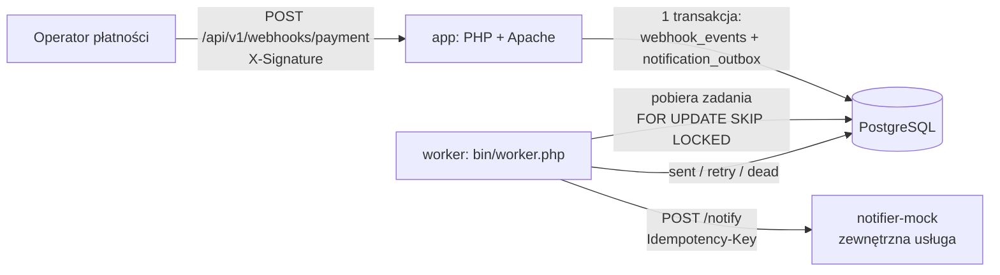

# Architektura: Payment Webhook Ingestion & Notification Pipeline

## 1. Cel i założenia

System przyjmuje od operatora płatności webhooki o zdarzeniach płatności i asynchronicznie powiadamia zespół sprzedaży. Dwie zasady stoją ponad resztą:

1. **Przyjęcie zdarzenia działa dokładnie raz.** Ta sama płatność nie wygeneruje drugiego powiadomienia, nawet gdy operator wyśle zdarzenie wielokrotnie albo równocześnie.
2. **Żadne przyjęte zdarzenie nie ginie.** Awaria usługi powiadomień nie blokuje przyjmowania webhooków, a niedostarczone powiadomienia czekają w Dead Letter Storage.

Świadomie nie używamy brokera wiadomości. Kolejką jest tabela w PostgreSQL (wzorzec Transactional Outbox). Uzasadnienie w sekcji 7.

## 2. Komponenty



| Usługa (compose) | Rola | Plik wejściowy |
|---|---|---|
| `app` | Endpoint webhooka: podpis, walidacja, zapis. Nie wysyła powiadomień. | `public/index.php` |
| `db` | Zdarzenia, kolejka (outbox), Dead Letter Storage | `db/schema.sql` |
| `worker` | Wysyłka powiadomień, ponowienia, DLQ | `bin/worker.php` |
| `notifier-mock` | Atrapa zewnętrznego API z trybami awarii | `mock/notifier.php` |

## 3. Ścieżka podstawowa (happy path)

1. Operator wysyła `POST /api/v1/webhooks/payment` z nagłówkiem `X-Signature: t=<unix>,v1=<hmac>`.
2. `app` sprawdza rozmiar i typ treści, podpis i świeżość znacznika czasu, potem waliduje payload.
3. W **jednej transakcji** zapisuje zdarzenie (`webhook_events`) i zadanie powiadomienia (`notification_outbox`), potem odpowiada `202 Accepted`. Cały proces to kilka milisekund i nie zależy od usługi powiadomień.
4. `worker` pobiera zadanie, wysyła powiadomienie (`order_id`, kwota, metoda płatności, sklep, kanał; bez danych osobowych) i oznacza zadanie jako `sent`.

### Model danych

| Tabela | Klucz | Najważniejsze kolumny |
|---|---|---|
| `webhook_events` | `event_id` (PK) | `event_type`, `transaction_id`, `order_id`, `amount_minor` (int, grosze), `currency`, `payment_method`, `store_id`, `channel`, `customer_id`, `payload_hash`, `received_at` |
| `notification_outbox` | `id`, `event_id` UNIQUE | `status` (`pending`, `processing`, `sent`, `dead`), `attempts`, `next_attempt_at`, `locked_until`, `last_error`, `sent_at` |
| `payments` (opcjonalnie) | `transaction_id` | `status`, `status_rank`, `last_event_id` |

E-maila, imienia, nazwiska i firmy klienta **nie zapisujemy**. Nie są potrzebne do powiadomienia (minimalizacja danych, RODO).

## 4. Scenariusze poza ścieżką podstawową

### 4.1 Race condition: dwa identyczne webhooki w tej samej milisekundzie

**Problem.** Operator może wysłać to samo zdarzenie dwa razy, np. przez ponowienie po timeoucie. Oba żądania mogą trafić do dwóch procesów PHP naraz. Klasyczne "sprawdź, czy istnieje, potem wstaw" (check-then-insert) przepuści oba, bo oba sprawdzą, zanim którekolwiek wstawi.

**Rozwiązanie.** O unikalności decyduje baza, a nie kod aplikacji:

```sql
INSERT INTO webhook_events (event_id, ...) VALUES (:event_id, ...)
ON CONFLICT (event_id) DO NOTHING
RETURNING event_id;
```

- PostgreSQL gwarantuje, że przy równoczesnych wstawieniach tego samego klucza drugie czeka na zakończenie transakcji pierwszego. Potem `DO NOTHING` nie zwraca wiersza.
- Zadanie w outboxie powstaje **tylko w transakcji, która faktycznie wstawiła zdarzenie**. Drugi proces dostaje pusty wynik i odpowiada `200 {"status":"duplicate"}`.
- Gdy pierwsza transakcja się wycofa, druga wstawi zdarzenie. Nadal mamy dokładnie jedno.
- Drugi bezpiecznik: `notification_outbox.event_id` też jest `UNIQUE`.
- Ten sam `event_id` z inną treścią (inny `payload_hash`) to nadal duplikat (200, wiążąca jest pierwsza wersja), ale z logiem `error` i hashem treści, na którym można ustawić alert, bo może oznaczać błąd operatora albo próbę nadużycia. Nie zwracamy 409: każda odpowiedź inna niż 2xx sprawia, że operator ponawia webhook w kółko.

To samo dotyczy workerów: zadania pobieramy zapytaniem `UPDATE ... WHERE id IN (SELECT ... FOR UPDATE SKIP LOCKED)` z dzierżawą (`locked_until`). Dwa workery nie wezmą tego samego zadania. Gdy worker padnie w trakcie, zadanie wraca do puli po wygaśnięciu dzierżawy.

**Odrzucone alternatywy.** Blokada w aplikacji (`flock`, mutex) nie działa między kontenerami. Redis `SETNX` to dodatkowa infrastruktura, a i tak potrzebujemy trwałego zapisu w bazie.

**Kod / dowód.** `src/Webhook/EventStore.php`, `src/Notification/Outbox.php`. Sprawdzone ręcznie (zapis w `sdd/dziennik.md`): 20 równoległych identycznych żądań daje 1×202 + 19×200, 1 zdarzenie, 1 zadanie i 1 powiadomienie. Dwa workery (`--scale worker=2`) i 31 zdarzeń dają 31 wysyłek (22 + 9), każde zadanie wysłane raz.

### 4.2 Out-of-order delivery: `charge.successful` przed utrwaleniem intencji płatności

**Problem.** Operatorzy nie gwarantują kolejności webhooków. `charge.successful` może przyjść, zanim zapiszemy `payment_intent.created`, albo zanim sklep utrwali zamówienie. Jeśli system zakłada kolejność, to albo odrzuci zdarzenie ("nie znam tej płatności"), albo późniejsze, starsze zdarzenie cofnie status z `COMPLETED` na `CREATED`.

**Rozwiązanie.**
1. **Każde zdarzenie jest samowystarczalne.** Payload `charge.successful` zawiera wszystko, czego potrzebuje powiadomienie (zamówienie, kwota, metoda). Powiadomienie nie czeka na intencję i niczego nie odrzucamy z powodu kolejności.
2. **Stan płatności zmienia się tylko do przodu.** Statusy mają rangę (`CREATED` = 1, `COMPLETED` / `FAILED` = 3, `REFUNDED` = 4). Aktualizacja to jeden atomowy upsert, który nadpisuje status tylko wyższą rangą:
   ```sql
   INSERT INTO payments (transaction_id, status, status_rank, last_event_id) VALUES (...)
   ON CONFLICT (transaction_id) DO UPDATE
     SET status = EXCLUDED.status, status_rank = EXCLUDED.status_rank, last_event_id = EXCLUDED.last_event_id
     WHERE payments.status_rank < EXCLUDED.status_rank;
   ```
   `charge.successful` przed intencją tworzy płatność od razu jako `COMPLETED`. Spóźnione `payment_intent.created` nic nie cofa. Kolejność oceniamy po randze statusu, a nie po `timestamp`, bo zegary operatora mogą mieć tę samą sekundę dla dwóch zdarzeń.
3. **Gdy proces biznesowy naprawdę potrzebuje wcześniejszych danych** (np. powiadomienie musi zawierać pozycje zamówienia ze sklepu, a zamówienia jeszcze nie ma), worker traktuje brak danych jak błąd przejściowy. Zadanie wraca do kolejki z backoffem, a po limicie prób trafia do DLQ. Webhook i tak przyjmujemy od razu, żeby nie zależeć od ponowień operatora.

**Kod / dowód.** Punkt 2 nie jest zaimplementowany (zabrakło czasu; następny krok w przekazaniu). Punkty 1 i 3 wynikają z budowy przepływu.

### 4.3 Awarie zewnętrznego API: backoff i Dead Letter Storage

**Problem.** Usługa powiadomień zwraca 5xx, nie odpowiada albo ogranicza ruch (429). Wysyłka w trakcie żądania webhooka spowolniłaby endpoint, a przy awarii zgubiłaby powiadomienie albo kazała operatorowi ponawiać cały webhook.

**Rozwiązanie.**
- Endpoint **nie wywołuje** usługi powiadomień, tylko zapisuje zadanie. Awaria usługi nie wpływa na przyjmowanie płatności.
- Worker klasyfikuje wynik wysyłki:

| Wynik | Klasyfikacja | Akcja |
|---|---|---|
| 2xx | sukces | `sent` |
| 5xx, 408, 429, timeout, błąd połączenia | przejściowy | `pending`, kolejna próba z backoffem |
| inne 4xx (400, 401, 404, 422) | trwały | `dead` od razu, bo ponawianie nic nie zmieni |
| limit prób przekroczony | trwały | `dead` |

- Backoff wykładniczy z jitterem: `opóźnienie = min(base * 2^(n-1), cap) + losowo do 20%`. Jitter rozprasza ponowienia wielu zadań, żeby po powrocie usługi nie uderzyły w nią naraz. Domyślnie `base = 2 s`, `cap = 300 s`, maksymalnie 6 prób. Parametry są w zmiennych środowiskowych. Na produkcję rekomendujemy dłuższy horyzont (np. 12 prób, `cap = 1 h`) i alert na każde zadanie w `dead`.
- **Dead Letter Storage** to status `dead` w tej samej tabeli, razem z `attempts` i `last_error`. Nic nie znika, a operator widzi, co i dlaczego nie dotarło. Komenda `bin/requeue.php <event_id>` przywraca zadanie po usunięciu przyczyny.
- Wysyłka ma timeout (5 s), więc zawieszona usługa nie blokuje workera.
- **Co najmniej raz, nie dokładnie raz.** Worker może paść po udanej wysyłce, a przed zapisem `sent`. Wtedy po wygaśnięciu dzierżawy wyśle powiadomienie jeszcze raz. Dlatego każde żądanie ma nagłówek `Idempotency-Key: <event_id>`, po którym odbiorca odrzuca duplikat (mock to robi). Tej gwarancji nie da się uzyskać bez współpracy odbiorcy. Lepiej powiedzieć to wprost, niż obiecywać "dokładnie raz".

**Kod / dowód.** `src/Notification/RetryPolicy.php`, `src/Notification/NotificationDispatcher.php`; `tests/Unit/RetryPolicyTest.php`. Sprawdzone ręcznie: mock w trybie `down` daje ponowienia po 1, 2 i 4 s, potem `dead`; `up` + requeue daje `sent`; tryb `reject` daje `dead` po 1 próbie.

### 4.4 Poison pills i uszkodzone payloady

**Problem.** Uszkodzone lub niekompletne żądanie nie może wywrócić procesu, zablokować kolejki ani zostawić nieczytelnego śladu. Logi nie mogą też ujawniać danych osobowych z payloadu.

**Rozwiązanie na wejściu (HTTP).** Kolejne bramki, każda z jasnym kodem i powodem:

| Sytuacja | Odpowiedź |
|---|---|
| metoda inna niż POST | 405 |
| treść powyżej 64 KB | 413 |
| `Content-Type` inny niż JSON | 415 |
| brak lub zły podpis, przeterminowany `t` | 401 (bez szczegółów, który element się nie zgadza) |
| niepoprawny JSON | 400 |
| brak pól, zły typ (np. kwota jako tekst), niedozwolona waluta | 422 z listą ścieżek pól, np. `data.transaction.amount.value: must be a non-negative integer` |
| nieznany typ zdarzenia | 202, zapis bez powiadomienia (operator nie ponawia w kółko) |
| nieoczekiwany wyjątek | 500 z samym `request_id` |

Podpis sprawdzamy **przed** parsowaniem JSON. Śmieci od nieuwierzytelnionego nadawcy nie docierają do parsera ani do bazy.

**Rozwiązanie w workerze.** Zadanie, którego nie da się dostarczyć (trwały 4xx), od razu trafia do `dead`, a worker bierze następne. Wyjątek przy jednym zadaniu jest łapany i zapisywany przy tym zadaniu, więc pętla działa dalej. Limit prób gwarantuje, że żadne zadanie nie krąży w nieskończoność. Dotyczy to też zadania, które za każdym razem zabija proces workera (fatal, brak pamięci): gdy jego dzierżawa wygaśnie po ostatniej dozwolonej próbie, worker przenosi je do `dead` (`Outbox::reapExhausted`), zamiast pobierać je ponownie.

**Czytelne logi.** Jedna linia JSON na zdarzenie, na stderr (`docker compose logs`). Zawiera tylko identyfikatory i powód, nigdy treść żądania ani dane osobowe:

```json
{"ts":"2026-11-23T10:15:02Z","level":"warning","msg":"webhook rejected","request_id":"9c1f...","reason":"validation_failed","errors":["data.transaction.amount.value"],"event_id":"evt_9f8d7c6b5a4321"}
```

Każda odpowiedź ma nagłówek `X-Request-Id`, więc błąd zgłoszony przez operatora łatwo znaleźć w logach.

**Kompromis (do uzgodnienia z operatorem).** Gdy podpis jest poprawny, a treść uszkodzona, zwracamy 4xx. Błąd jest wtedy widoczny w panelu operatora, a operator może go ponawiać. Alternatywa to 2xx z zapisem surowej treści do kwarantanny: operator przestaje ponawiać, ale trzymamy u siebie dane osobowe z uszkodzonego payloadu. Na start wybieramy 4xx, bo nie zbiera danych i stawia błąd tam, gdzie powstał.

**Kod / dowód.** `src/Security/SignatureVerifier.php`, `src/Webhook/PayloadValidator.php`, `src/Http/WebhookController.php`; `tests/Unit/*Test.php`; sprawdzone ręcznie: 401, 400, 405, 415, 422.

## 5. Bezpieczeństwo

- **Podpis HMAC-SHA256** z `"<t>.<surowa treść>"`, porównywany `hash_equals` (odporny na ataki czasowe). Schemat wzorowany na Stripe. Po wyborze operatora podmieniamy jedną klasę.
- **Ochrona przed powtórzeniem (replay):** znacznik `t` starszy niż 300 s jest odrzucany. Przechwyconego żądania nie da się użyć później, a w oknie 300 s chroni idempotentność `event_id`.
- **Sekret** tylko w zmiennej środowiskowej. Pusty sekret zatrzymuje aplikację przy starcie, zamiast przyjmować wszystko. Wartość w `docker-compose.yml` jest wyłącznie lokalna i deweloperska.
- **SQL** wyłącznie przez PDO z parametrami.
- **Dane osobowe:** nie trafiają do bazy, logów ani powiadomień (sekcja 3).
- **Kwoty** jako liczby całkowite w groszach, nigdy float.

## 6. Semantyka dostarczenia (podsumowanie)

| Etap | Gwarancja | Mechanizm |
|---|---|---|
| Przyjęcie webhooka | dokładnie raz | unikalny `event_id` + `ON CONFLICT DO NOTHING` |
| Zapis zdarzenia i zadania | atomowo | jedna transakcja (Transactional Outbox) |
| Pobranie zadania przez worker | jeden worker na zadanie | `FOR UPDATE SKIP LOCKED` + dzierżawa |
| Wysyłka powiadomienia | co najmniej raz | ponowienia + `Idempotency-Key` u odbiorcy |

## 7. Dlaczego bez Message Brokera (na dziś)

Kolejka w PostgreSQL daje to, czego teraz potrzebujemy: trwałość, atomowy zapis ze zdarzeniem, ponowienia, DLQ i wielu workerów. Nie dochodzi przy tym kolejny system do utrzymania. Broker (RabbitMQ, SQS, Kafka) ma sens, gdy:
- liczba zdarzeń przekroczy możliwości jednej bazy (rzędu setek na sekundę, do potwierdzenia pomiarem),
- dojdą kolejni konsumenci tych samych zdarzeń (np. 5 kanałów, raporty) i chcemy ich od siebie odseparować.

Wtedy outbox zostaje, a worker zamiast wysyłać powiadomienie publikuje zdarzenie do brokera. Zapis z gwarancją atomowości się nie zmienia, więc migracja nie wymaga przepisania endpointu.

## 8. Ograniczenia i dalsze kroki

- Format podpisu konkretnego operatora (Stripe, PayU) i kontrola `livemode` do wdrożenia po jego wyborze.
- Monitoring: liczba zadań w `dead`, wiek najstarszego `pending`, odsetek 4xx na endpoincie, z alertami.
- Retencja `webhook_events` i `notification_outbox` (np. archiwizacja po 90 dniach) do ustalenia z klientem.
- Rate limiting i TLS na poziomie infrastruktury (reverse proxy / load balancer).
